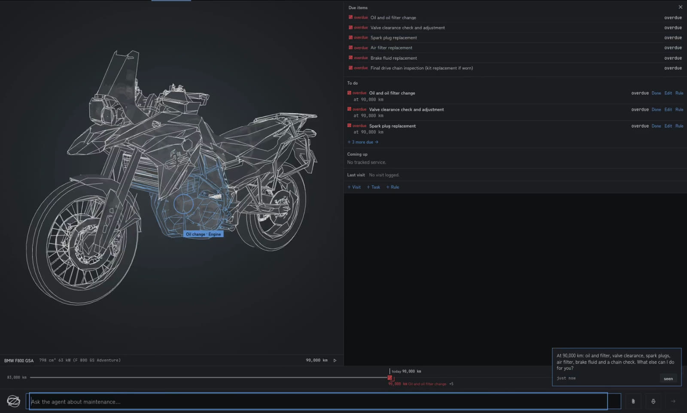

# Soyuka's garage

[](https://github.com/soyuka/garage/actions/workflows/ci.yml)

A maintenance tracker for my own vehicles, exposed as an MCP server, with a 3D workshop in the browser that any
MCP client can drive. Entry for the Symfony AI & MCP hackathon.

[](https://www.youtube.com/watch?v=UFa4OIt4OM0)

[Watch the demo (70 s)](https://www.youtube.com/watch?v=UFa4OIt4OM0)

## What it does

I use this app for my personal garage: a Mazda6, a Renault Espace IV, a BMW F 800 GS and a ride-on mower. It's
also the project where I test the new MCP features and experiment with what's possible.

You talk to it, it answers in the **Atelier**. Ask what's due on the bike and the bike drives in, the overdue
items are pinned on the 3D model and the task list opens. Ask for an oil filter and you get the references that
actually fit, narrowed down to the parts that are physically different. Ask how to remove the passenger airbag and
the workshop manual opens at the right page. Log a visit and the planned task closes, the forecast moves.

There are two ways in:

- the Atelier has its own agent (Symfony AI), with a prompt box, voice and file uploads (drop the registration
  card, it fills the vehicle in)
- or connect any MCP client (Claude Code, Claude Desktop, claude.ai): it gets the same tools, and the Atelier
  still reacts to its calls. With MCP Apps, the service history renders right inside the conversation.

Parts come from **bonneref**, a second Symfony app in this repository that serves a TecDoc catalogue as its own MCP
server.

Built with Symfony 7, API Platform 5 (`api-platform/mcp`), `symfony/mcp-bundle` and the PHP MCP SDK, Symfony AI,
Mercure, React and react-three-fiber.

## Run it

You need Docker with Compose and the ports 8480 to 8482 free on loopback.

```bash
git clone https://github.com/soyuka/garage.git
cd garage
bin/demo
```

The first run generates the secrets and a `demo` password into `.demo/env`, seeds the garage and prints the URLs:

```
  Atelier              http://localhost:8480
  mpa MCP server       http://localhost:8480/mcp
  bonneref MCP server  http://localhost:8481/mcp
  Casdoor (issuer)     http://localhost:8482
  Login                demo / <generated>
  claude mcp add --transport http garage http://localhost:8480/mcp
  claude mcp add --transport http bonneref http://localhost:8481/mcp
```

Open the Atelier and log in as `demo`. Then in Claude Code, add the server and run `/mcp`: the client registers
itself and opens the login page, there's no client id to copy. Try these, in order:

1. `What's due on the Mazda?`
2. `Which oil filter should I order for the Mazda? Narrow it down to the physically different parts and compare brands.`
3. `When did I last change the oil on the Mazda? Show me the logbook.`
4. `Show me where the fuel filter sits on the Mazda.`
5. `I've just replaced the fuel filter on the Mazda, at 252 524 km. Log it.`

No API key is needed, your MCP client does the reasoning. Set `ANTHROPIC_API_KEY` before `bin/demo` to turn on
the Atelier's own agent and the bonneref finder. `bin/demo reset` puts the garage back, `bin/demo down` stops it,
`bin/demo info` prints the URLs again.

<details>
<summary>More about the demo stack</summary>

- `bin/demo` pulls `ghcr.io/soyuka/mon-parc-auto-{api,atelier,bonneref}:main` (published by CI after a green
  `main`) and builds from the checkout when a pull fails. About 30 s to a running stack with the images, 3 min on a
  cold build. `bin/demo --build` forces the build. Ports can be moved with `DEMO_PORT`, `BONNEREF_PORT` and
  `AUTH_PORT` before the first run.
- The garage is [`api/fixtures/demo/`](api/fixtures/demo/), exported from mine with the plates and VINs replaced.
  The catalogue is [`data/catalog-demo.sqlite`](data/catalog-demo.sqlite), a 46 MB slice of a TecDoc 2020
  extract that only answers for the Mazda6, the Espace IV and the F 800 GS
  ([what it keeps](docs/tecdoc-sqlite.md#demo-slice-datacatalog-demosqlite-2026-11-13)).
- MCP answers follow the request's `Accept-Language` (`claude mcp add … --header "Accept-Language: fr"`), the
  Atelier has its own EN/FR switch.
- The development stack is described in [`CLAUDE.md`](CLAUDE.md) and [`api/docs/AUTH.md`](api/docs/AUTH.md).

</details>

## Fixed upstream on the way

- [api-platform/core#8845](https://github.com/api-platform/core/pull/8845) (merged, in 5.0.7): nullable object
  collections lost `null` in the generated JSON Schema, MCP clients had their tool arguments rejected.
- [symfony/ai#2220](https://github.com/symfony/ai/pull/2220) (merged): the generic platform bridge crashed when a
  provider (Qwen) streamed an empty tool-call id on continuation deltas.
- [symfony/ai#2196](https://github.com/symfony/ai/pull/2196) (merged): Anthropic server-side tools through a
  `server_tools` option, used by the agent's web search.
- [api-platform/core#8332](https://github.com/api-platform/core/issues/8332) (issue, closed): a property added to an
  existing resource stayed missing until `var/cache` was deleted.

## Still to send upstream

Things I worked around in the app that belong in the libraries:

- symfony/ai: a toolbox over an in-process MCP server, so an agent calls the MCP tools without redeclaring them
  ([`McpToolbox.php`](api/src/Mcp/Agent/McpToolbox.php)), and a way to give one agent several toolboxes
  ([`CompositeToolbox.php`](api/src/Agent/Toolbox/CompositeToolbox.php)).
- symfony/ai-bundle: `#[AsTool]` is only autoconfigured on the class, not on methods
  ([`EndTurnTool.php`](api/src/Agent/Ui/EndTurnTool.php)).
- symfony/ai-platform: the Anthropic and Gemini result converters drop the web search citations
  ([`AnthropicWebSearchClient.php`](api/src/Agent/WebSearch/AnthropicWebSearchClient.php)), and there's no way to put
  a prompt-cache breakpoint on a given message
  ([`AttachmentCacheBreakpointNormalizer.php`](api/src/Agent/Attachment/AttachmentCacheBreakpointNormalizer.php)).
- mcp/sdk: a domain error thrown by a tool comes back as a generic `-32603`, the model can't fix its call
  ([`DomainErrorHandler.php`](api/src/Mcp/DomainErrorHandler.php)), and `Protocol` keeps dropped request ids forever
  in a long-lived worker.
- symfony/mcp-bundle: RFC 9728 protected resource metadata and the `WWW-Authenticate` challenge, on top of Symfony
  Security. The SDK has a PSR-15 middleware for it but the bundle doesn't wire it
  ([`ProtectedResourceMetadataController.php`](api/src/Controller/Mcp/ProtectedResourceMetadataController.php),
  [`McpProtectedResourceChallengeListener.php`](api/src/EventListener/McpProtectedResourceChallengeListener.php)).

## Status

A hackathon entry and a prototype, that I use on my own vehicles. CI
([`ci.yml`](.github/workflows/ci.yml)) runs php-cs-fixer, Mago (no baseline) and PHPUnit on both Symfony apps,
vitest and a production build on both fronts.

## License

[MIT](LICENSE) for the code. The TecDoc catalogue slice, the vehicle documents in the demo garage and some
third-party 3D assets are there for the demo only and keep their own terms
([`docs/public-audit.md`](docs/public-audit.md)).
